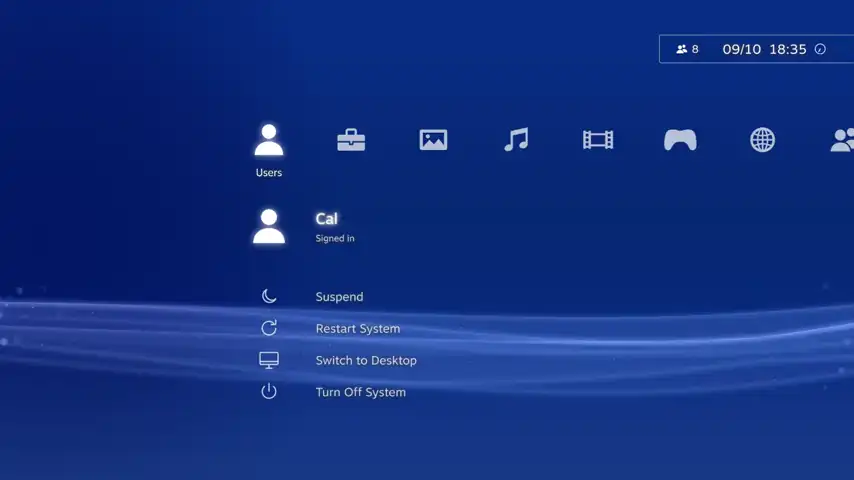
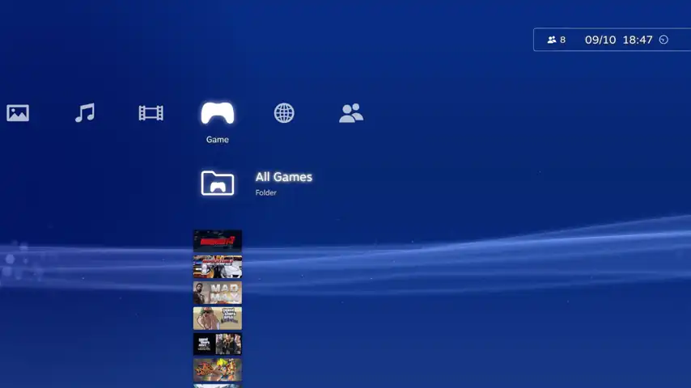
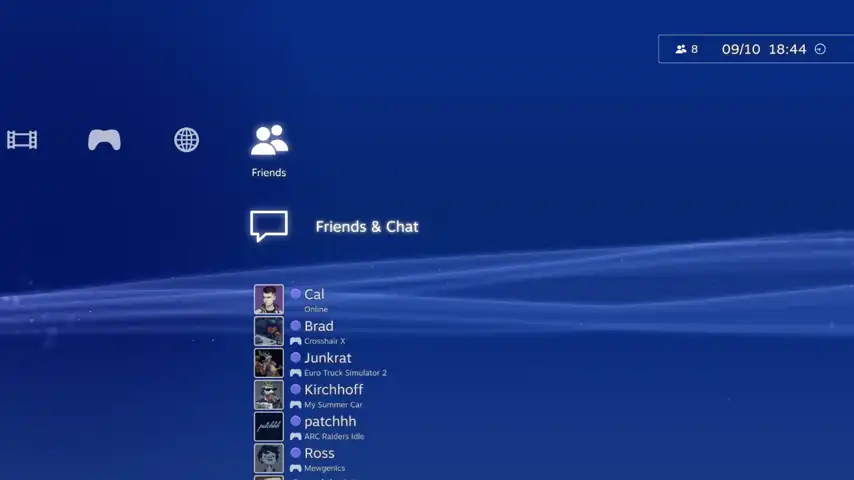
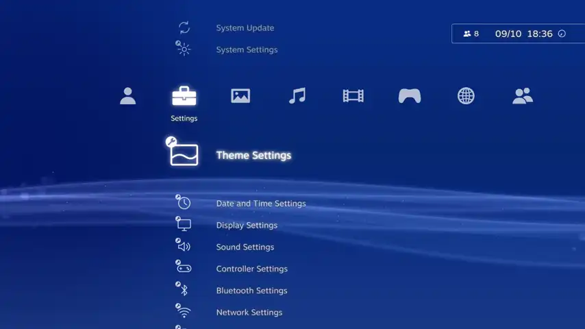
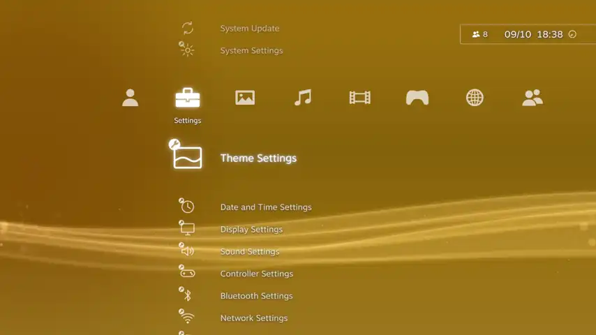
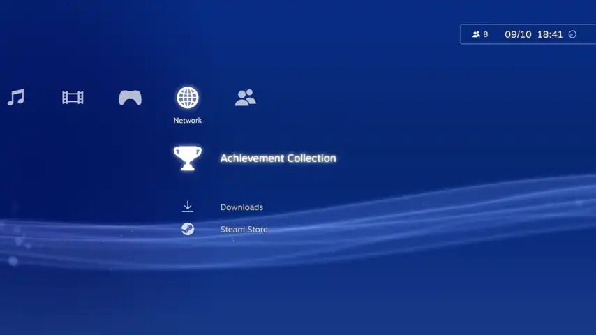
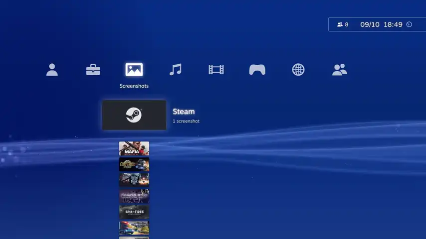

# DeckyXMB

A [Decky Loader](https://decky.xyz) plugin that replaces the Steam Deck home screen with a PS3-style **XrossMediaBar**.



Category bar: **Users · Settings · Screenshots · Soundtracks · Video · Game · Network · Friends**.

## Install on the Steam Machine / Steam Deck

1. Install Decky Loader. In Decky settings → General, turn on **Developer mode**.
2. Copy `DeckyXMB-x.y.z.zip` to the Deck, then go to Decky → Developer → **Install Plugin from ZIP**.

Turning off "Use XMB as Home" or uninstalling the plugin brings Steam's normal home back right away. If a Steam update breaks something, the plugin falls back to Steam's home.

PS3 themes, packages and `.rap` files are not included. Use your own.

<p align="center">
    <a href="https://dl.insanux.com/?mod=U798L1uB0QK94kX">
        
    </a>
    <a href="https://www.patreon.com/c/InsaneCallum">
        
    </a>
</p>

## Previews

Recorded on a Steam Machine.

| | |
| :---: | :---: |
| **Games**<br>Moving through the Game column, each game's art and background fading in | **Profile and friends**<br>Your own profile card, then a friend's |
| [](docs/game_preview.mp4) | [](docs/friends_preview.mp4) |
| **Custom themes**<br>Installing a PS3 theme and applying it | **Theme colour**<br>Changing the Original theme's wave colour |
| [](docs/theme_preview.mp4) | [](docs/colour_preview.mp4) |
| **Trophies**<br>A game's trophies, PS3-style | **Screenshots**<br>Screenshots by game, in a picture grid |
| [](docs/trophy_preview.mp4) | [](docs/screenshots_preview.mp4) |

## Features

- **Themes**
  - The Original theme's animated wave changes colour with the month and dims at night.
  - Installs Official/Unofficial **PS3 themes** (`.p3t`, or the theme inside a PS3 `.pkg`), including **dynamic themes** with animated 3D backgrounds, drawn with WebGL and directed by the theme's own script.
  - Licence-locked themes are unlocked with their `.rap`.
  - A theme's icons replace the XMB's own, and its background can be dimmed or drawn at a lower resolution to save power.
- **Game**
  - Folders for All Games, Favorites, Locally Installed Games and your Steam collections, each one switched on or off with △.
  - Below the folders: your recently played games.
  - The selected game's art fades in behind the menu, like PS3 game backgrounds.
  - ✕ on a game opens its options: Play, Achievements, Game Details, Move to Video and More Options (Steam's own menu).
- **Video:** an empty column for the "games" you choose. Move a game here with Move to Video, and back with Move to Game. Such as YouTube/Plex.
- **Trophies**
  - Steam achievements shown as PS3 trophies. Rarity sets the grade: under 10% of players is gold, under 35% silver, otherwise bronze. Earning everything unlocks platinum.
  - Achievement Collection (under Network) lists every game's trophies in the XMB, or on a full trophy page.
  - Non-Steam games show their [RetroAchievements](https://retroachievements.org) trophies with [Emuchievements](https://github.com/Xriuk/Emuchievements): games it can't match are matched by name, through the account you've signed in to Emuchievements with.
- **Screenshots:** the ones on the Deck and the ones uploaded to your Steam profile, by game, in a picture grid.
- **Soundtracks:** the Steam soundtracks you own, with their track lists; downloaded tracks play right in the XMB.
- **Friends**
  - In the PS3 list style: avatar, presence and what they're playing. The selected friend gets the large card with their game art.
  - Your own entry at the top, with your level, latest trophies and colour.
- **Settings:** the PS3's settings, made with Steam's own:
  - System Update; Theme; Date and Time; Display; Sound; Controller; Bluetooth; Network.
  - Controller Symbols sets the button symbols shown throughout Steam: DualShock 3, DualShock 2 or Steam's own (CSSLoader Icon Replacers will work).
- **Game music on hover:** with [ThemeDeck](https://github.com/BrenticusMaximus/ThemeDeck), resting on a game plays its ThemeDeck track. It stops when a game launches.
- **Power items** (Suspend, Restart, Switch to Desktop, Turn Off) ask first, as the PS3 does.

## Controls

| Steam Deck | PS3 | Action |
| --- | --- | --- |
| D-pad ◀ ▶ | | Switch category (in a folder, ◀ goes back) |
| D-pad ▲ ▼ | | Move through items |
| L1 / R1 | | Jump 6 items up / down |
| A | ✕ | Open the item. On a game: its options (or Play, or its page: set in Quick Access) |
| B | ○ | Back |
| Y or ≡ | △ | Options for the selected item |

Settings are in Quick Access (…) → DeckyXMB, and inside the XMB under Settings.

## Build

```bash
npm install
npm run build      # → dist/index.js
npm run package    # → release/DeckyXMB-<version>.zip
npm run preview    # browser preview with a fake library at http://localhost:5178
```

In the preview the arrow keys are the D-pad. Enter = ✕, Esc = ○, Y = △, X = □, Q/E = L1/R1.

## Credits

Made by **InsaneCallum**. If you enjoy it, you can support me on [Patreon](https://www.patreon.com/c/InsaneCallum).

The DualShock controller symbols come from [Button Prompts Galore](https://github.com/Callum-Bell/sdh-controller-prompts) (ZeusOfTheCrows and InsaneCallum, CC0).

The home-route patch, Steam store access and native menu lookup are adapted from
[Spindeck](https://github.com/justinca92/spindeck) (BSD-3-Clause). See `NOTICE`.

> [!NOTE]
> **AI Generated Content Disclosure**
> Heavy AI usage was used to allow this project to be possible.
> Any project's made by myself will have an AI disclosure if it has been used.
